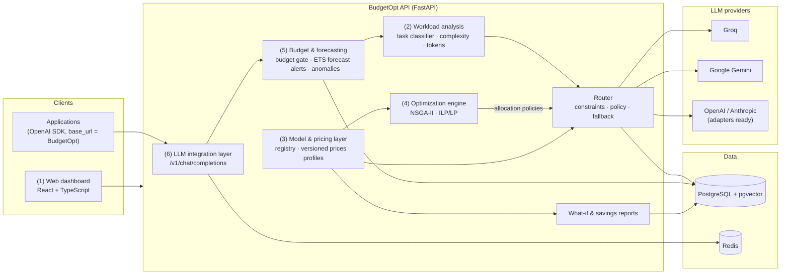
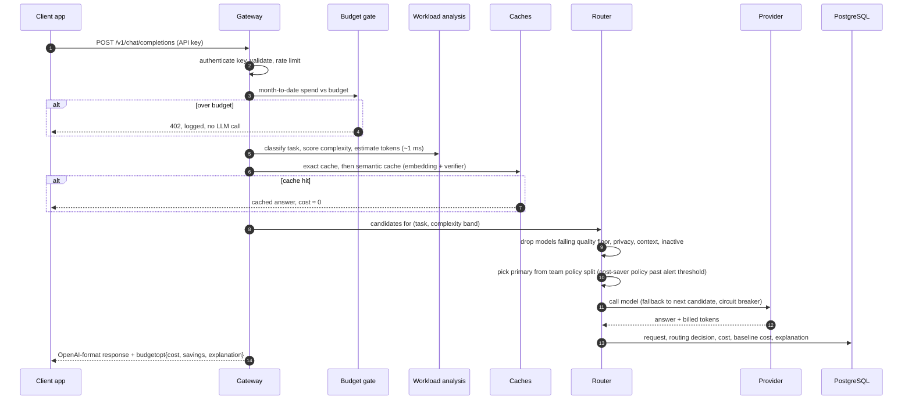
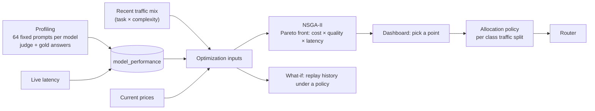

# BudgetOpt — architecture

How the system described in the project report's *Proposed System Architecture* is built.
Each numbered component below matches the report's list.

## Components



| # | Report component | Implementation |
|---|---|---|
| 1 | Web dashboard | `frontend/`: React 18, TypeScript, Vite, Tailwind, TanStack Query, Recharts |
| 2 | AI workload analysis | `backend/app/services/workload/`: TF-IDF + logistic-regression task classifier (8 task types), complexity score and band, input/output token estimates; about 1 ms per request |
| 3 | Model and pricing layer | `llm_models`, versioned `model_pricing`, `model_performance` (quality per task from `services/profiling/quality.py`, latency p50/p95 from `services/profiling/latency.py`) |
| 4 | Optimization engine | `backend/app/services/optimizer/`: NSGA-II (pymoo) over cost, quality and latency; exact ILP/LP (OR-Tools) for single objectives and validation; results become allocation policies |
| 5 | Budget and forecasting | `services/budget.py` (soft/hard limits), `services/forecasting.py` (ETS with simulated intervals), `services/alerts.py`, `services/anomaly.py`, `services/scheduler.py` |
| 6 | LLM integration layer | `api/v1/gateway.py`: OpenAI-compatible `/v1/chat/completions`, team API keys, rate limits, exact and semantic caches |
| — | Database | PostgreSQL 16 with pgvector (semantic cache index); Redis for the exact cache, rate limits and login throttling |

## Life of a request



Every outcome, including blocked, cached and failed requests, is logged with a
plain-language explanation that the dashboard's request log shows.

## Optimization loop



## Data model (main tables)

| Area | Tables |
|---|---|
| Organization | `organizations`, `teams` (budget, alert threshold, privacy tier, policies), `users` (role), `api_keys` (hashed) |
| Models | `providers` (encrypted key), `llm_models`, `model_pricing` (versioned), `model_performance`, `profiling_results` |
| Traffic | `requests` (task, complexity, tokens, cost, latency, status), `routing_decisions` (candidates, baseline, savings, explanation) |
| Optimization | `optimization_runs` (inputs, Pareto front), `allocation_policies` (rules per class) |
| Monitoring | `forecasts`, `alerts`, `audit_events`, `semantic_cache_entries` (pgvector) |

Migrations: `backend/migrations/` (Alembic). Money is stored as `NUMERIC(18, 8)` USD so
fractions of a cent per request are exact.

## Code map

```
backend/app/
  api/v1/        auth, users, teams, models, providers, gateway, requests, profiling,
                 optimization, monitoring, analysis (what-if, savings)
  core/          settings, security (argon2, JWT, Fernet), RBAC dependencies, Redis
  db/            ORM models, session
  services/
    providers/   one adapter per provider (Groq, Gemini, OpenAI, Anthropic)
    routing/     pipeline, router, fallback executor, circuit breaker
    workload/    classifier, complexity, token estimates (+ trained artifacts)
    profiling/   quality harness, latency profiles, answer checks
    optimizer/   problem, NSGA-II, ILP/LP, policies, service
    budget, forecasting, alerts, anomaly, scheduler, cache, semantic_cache,
    rate_limit, login_guard, privacy, pricing, whatif, savings
  demo_traffic.py  synthetic history for demonstrations (separate team)
backend/perf/    routing-overhead load test
ml/              datasets, labelling, training and evaluation scripts
frontend/src/    pages, components, API client
docs/            plan, architecture, security, evaluation, demo script
```

## Deployment

`docker compose up --build` starts PostgreSQL (pgvector), Redis, the API (runs migrations and
the seed, then serves on :8000) and the dashboard (nginx on :8080, proxying `/api` and `/v1` to
the API). The API's health check gates the dashboard start. Configuration is by environment
variables (`.env.example`); outside development the API refuses to start with default secrets.
