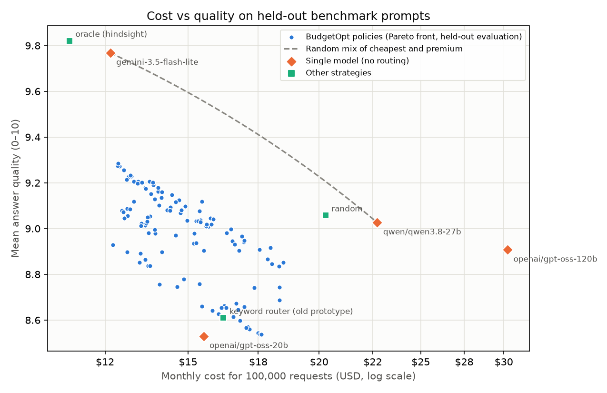

# Routing benchmark

151 held-out prompts (never used to train the classifier, not in the
profiling set) × 4 models: openai/gpt-oss-20b, gemini-3.5-flash-lite, openai/gpt-oss-120b, qwen/qwen3.8-27b. Every model
answered every prompt once; math answers were checked against gold answers and all other
answers were graded 1–10 by a judge outside the benchmark models ({'gemma-4-26b-a4b-it': 524, 'gold-answer': 80}).
Strategies are scored by looking up the real answer of the model they pick (response-matrix
evaluation, as in RouterBench / RouteLLM). Costs use current list prices, projected to
100,000 requests a month.

BudgetOpt's allocation policies were optimised from **profiling data only**; the benchmark
answers were never used to build them. Quality floors per complexity band: {'low': 6.0, 'medium': 7.0, 'high': 8.0}.

**Premium baseline.** Google's stronger models (Gemini 3.5 Flash, Gemini 3 Flash preview) allow
only 20 free requests a day, too few for this matrix, so the premium baseline is the most
expensive model free tiers can serve at this volume (qwen/qwen3.8-27b). The price spread between the
cheapest and the premium benchmark model is therefore about 4×; with commercial premium models
(≈20× and more) the same routing decisions would save correspondingly more.

| Strategy | Quality | Kept vs premium | Monthly cost | Saved vs premium | vs random mix | p95 |
|---|---|---|---|---|---|---|
| all → openai/gpt-oss-20b | 8.53 | 94% | $15.52 | 32% | -1.03 | 2.0 s |
| all → gemini-3.5-flash-lite | 9.77 | 108% | $12.65 | 44% | +0.00 | 27.1 s |
| all → openai/gpt-oss-120b | 8.91 | 99% | $30.25 | -33% | -0.12 | 2.6 s |
| all → qwen/qwen3.8-27b | 9.03 | 100% | $22.72 | 0% | +0.00 | 2.2 s |
| random | 9.06 | 100% | $20.28 | 11% | -0.15 | 22.1 s |
| keyword router (old prototype) | 8.61 | 95% | $16.21 | 29% | -0.90 | 2.0 s |
| oracle (hindsight) | 9.82 | 109% | $11.56 | 49% | +0.05 | 26.3 s |
| BudgetOpt cheapest-eligible (no policy) | 9.21 | 102% | $13.32 | 41% | -0.51 | 25.8 s |
| BudgetOpt cost_saver | 9.21 | 102% | $13.32 | 41% | -0.51 | 25.8 s |
| BudgetOpt quality_first | 9.28 | 103% | $12.86 | 43% | -0.47 | 25.9 s |
| BudgetOpt balanced | 9.18 | 102% | $14.05 | 38% | -0.49 | 24.7 s |

*vs random mix*: quality gained over randomly splitting traffic between the cheapest and the
premium model at the same cost (positive = the routing decisions add value).

## Quality by task type (balanced policy)

| Task type | Prompts | Cheapest model | BudgetOpt balanced | Premium model |
|---|---|---|---|---|
| analysis | 20 | 8.55 | 9.44 | 10.0 |
| coding | 20 | 8.9 | 10.0 | 10.0 |
| creative writing | 20 | 7.3 | 9.36 | 9.05 |
| extraction | 20 | 9.55 | 9.95 | 9.2 |
| reasoning math | 20 | 6.0 | 6.0 | 7.0 |
| simple qa | 20 | 9.45 | 10.0 | 8.7 |
| summarization | 11 | 9.45 | 9.82 | 9.18 |
| translation | 20 | 9.45 | 9.15 | 9.15 |

Workload classes seen: `{'translation:low': 21, 'coding:medium': 15, 'analysis:medium': 18, 'extraction:medium': 15, 'summarization:medium': 1, 'summarization:low': 6, 'creative_writing:low': 22, 'extraction:low': 6, 'simple_qa:medium': 11, 'simple_qa:high': 9, 'simple_qa:low': 2, 'coding:high': 1, 'coding:low': 3, 'reasoning_math:high': 13, 'reasoning_math:medium': 7, 'analysis:high': 1}`
Notes: ['reasoning_math:high: no model reaches quality 8.0; relaxed to best available (7.5)']
Models without a quality profile: none
