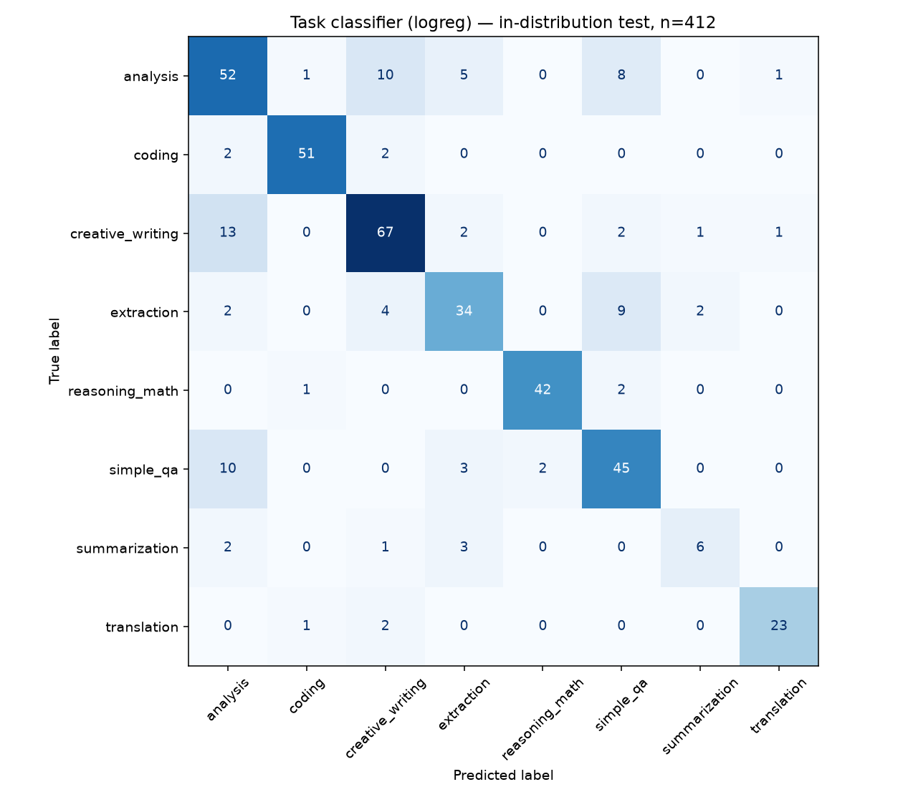
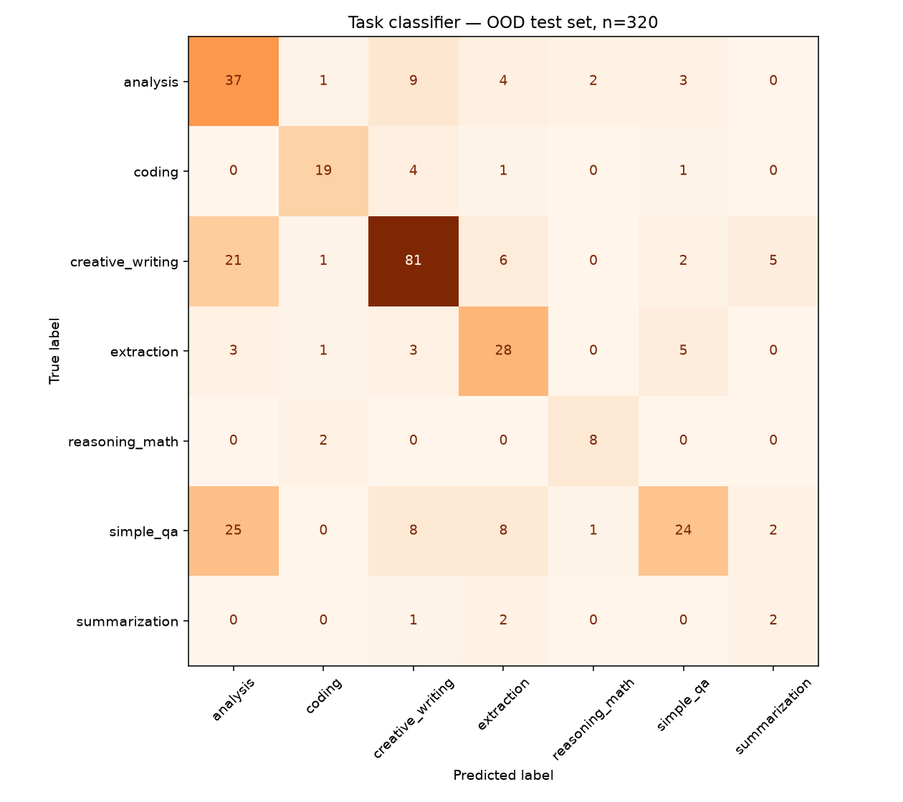

# Task classifier — evaluation

Data: 3275 train / 409 validation / 412 test prompts across
8 task types: prompts from six public datasets, all labelled by one LLM
annotator with one rubric (`ml/labeling_run.py`, stage `annotate`).

Annotator agreement with each dataset's own labels (sanity check):
`{"codealpaca": 0.846, "dolly": 0.584, "gsm8k": 1.0, "math": 0.987, "mbpp": 1.0}`

## Model selection (validation macro-F1)

| Model | Hyper-parameters | Val macro-F1 |
|---|---|---|
| logreg | {'C': 1.0} | 0.7854 |
| logreg | {'C': 4.0} | 0.7886 |
| logreg | {'C': 16.0} | 0.7811 |
| linear_svm | {'C': 0.25} | 0.7838 |
| linear_svm | {'C': 1.0} | 0.7776 |
| linear_svm | {'C': 4.0} | 0.766 |
| complement_nb | {'alpha': 0.1} | 0.7247 |
| complement_nb | {'alpha': 0.3} | 0.736 |
| complement_nb | {'alpha': 1.0} | 0.7307 |

**Selected:** logreg

## Held-out test set

- Accuracy: **0.777**
- Macro-F1: **0.775**
- Inference latency: **0.46 ms** per prompt (single-threaded CPU)

```
                  precision    recall  f1-score   support

        analysis      0.642     0.675     0.658        77
          coding      0.944     0.927     0.936        55
creative_writing      0.779     0.779     0.779        86
      extraction      0.723     0.667     0.694        51
  reasoning_math      0.955     0.933     0.944        45
       simple_qa      0.682     0.750     0.714        60
   summarization      0.667     0.500     0.571        12
     translation      0.920     0.885     0.902        26

        accuracy                          0.777       412
       macro avg      0.789     0.765     0.775       412
    weighted avg      0.779     0.777     0.777       412

```

Confidence vs accuracy: `{"conf>=0.5": {"share": 0.762, "accuracy": 0.8694}, "conf>=0.7": {"share": 0.558, "accuracy": 0.9478}, "conf>=0.9": {"share": 0.267, "accuracy": 0.9818}}`



## Out-of-distribution test set

320 natural Alpaca prompts that the dataset rules did not label, annotated
independently by an LLM ({'openai/gpt-oss-120b': 320}). This is the more honest estimate of
real-world accuracy.

- Accuracy: **0.622**
- Macro-F1: **0.596**
- Top-2 accuracy: **0.797**
- Inter-annotator agreement (a second LLM annotator on the same prompts):
  **0.719** — the practical ceiling for any classifier on these labels, since
  the task types genuinely overlap (e.g. "edit this text", "explain this code")
- Label distribution: `{'analysis': 56, 'coding': 25, 'creative_writing': 116, 'extraction': 40, 'reasoning_math': 10, 'simple_qa': 68, 'summarization': 5}`

```
                  precision    recall  f1-score   support

        analysis      0.430     0.661     0.521        56
          coding      0.792     0.760     0.776        25
creative_writing      0.764     0.698     0.730       116
      extraction      0.571     0.700     0.629        40
  reasoning_math      0.727     0.800     0.762        10
       simple_qa      0.686     0.353     0.466        68
   summarization      0.222     0.400     0.286         5

        accuracy                          0.622       320
       macro avg      0.599     0.625     0.596       320
    weighted avg      0.657     0.622     0.622       320

```


